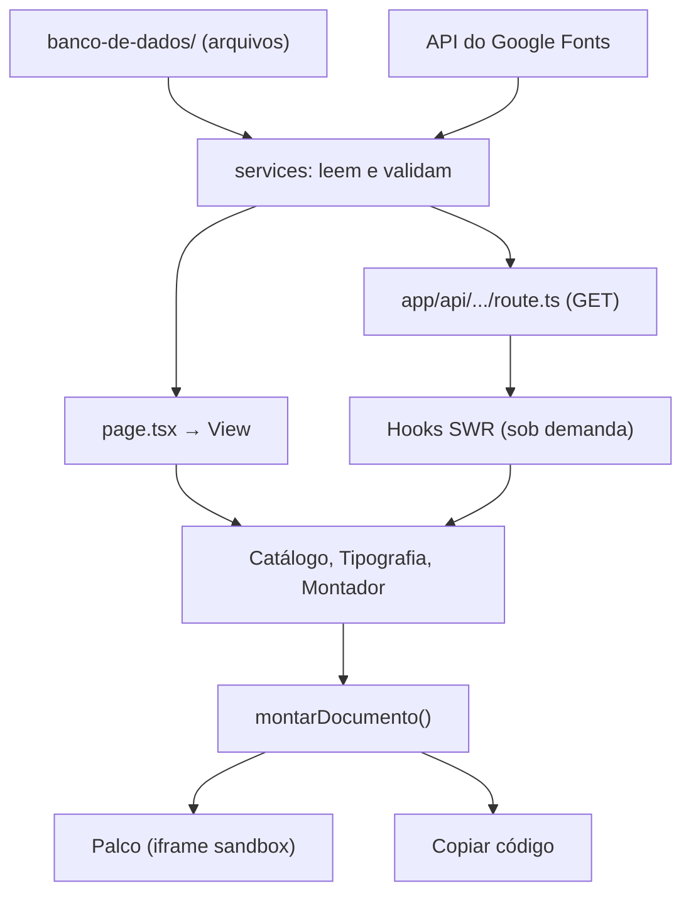

# Documentação do Software — animaqui

| Campo | Valor |
|---|---|
| **Versão do documento** | 0.13 |
| **Data** | 16/11/2026 |
| **Autor(es)** | Daniel (responsável), Claude (redação) |
| **Status** | Em revisão: E-02 (e-commerce) com S09 a S11 entregues; S08 na fila (dados legais e publicação) |
| **Aprovado por** | Pendente |

## Histórico de Revisões

| Versão | Data | Autor | Descrição da alteração |
|---|---|---|---|
| 0.1 | 02/11/2026 | Claude | Criação do documento a partir da visão de produto do Daniel e proposta de arquitetura (E-01). Nenhum código alterado. |
| 0.2 | 02/11/2026 | Claude | E-01/S01 parcial: arquitetura alinhada ao padrão do 04Sorteio e do ZapCrud, nomes aprovados pelo Daniel e árvore criada com arquivos vazios. SQL: nenhum |
| 0.3 | 02/11/2026 | Claude | E-01/S01 parcial: árvore igualada à do 04Sorteio, a pedido do Daniel. Saem `regras.ts`, `regras.test.ts`, `robots.ts`, `sitemap.ts` e `app/page.tsx`; `views/publico` vira `views/client`; entra `views/shared/NotFound`. Sem testes automatizados. SQL: nenhum |
| 0.4 | 02/11/2026 | Claude | E-01/S01 parcial: seções, animações e tema movidos para `banco-de-dados/`, fora do `src`, a pedido do Daniel. Features só com `components`, `hooks`, `services` e `types`. SQL: nenhum |
| 0.6 | 02/11/2026 | Claude | E-01/S01 a S06: Tailwind removido, motor, palco, visual clay/poster e os três módulos funcionando, com 7 seções e 7 animações de amostra. Testado: `tsc`, `eslint`, `build` e bateria no navegador (Edge) cobrindo os CT da seção 7. SQL: nenhum |
| 0.7 | 02/11/2026 | Claude | Paleta trocada a pedido do Daniel: interface monocromática, com cores variadas só nos detalhes. Testado: `tsc`, `eslint`, `build` e a mesma bateria. SQL: nenhum |
| 0.8 | 02/11/2026 | Claude | E-01/S07: acervo vindo das landing pages e do cofre, sem dados de cliente: 52 seções em 12 categorias e 14 animações. Testado: 832 combinações (seção, largura e animação) no Edge, sem erro de script nem rolagem lateral. SQL: nenhum |
| 0.9 | 02/11/2026 | Claude | Otimização sem mudança visual e erro do modo dev corrigido. Palco troca sem recarga dupla nem tela vazia, palcos escondidos param, cópia só com tudo carregado, rotas GET sem `generateStaticParams`, com cache HTTP. Testado: `tsc`, `eslint`, `build` e 3 partidas a frio do modo dev. A rodada final no navegador foi interrompida por falta de memória na máquina e ainda precisa ser repetida. SQL: nenhum |
| 0.10 | 02/11/2026 | Claude | E-01/S08 parcial, a pedido do Daniel ("obrigações do site"): `robots`, `sitemap`, canonical, Open Graph, ícones, JSON-LD, `llms.txt`, `/privacidade`, `/termos`, rodapé com os links e headers de segurança. README refeito. Testado: `tsc`, `eslint`, `build`, `npm audit` e CT-500 a CT-505 no Edge em produção. A bateria completa dos CT não foi repetida. SQL: nenhum |
| 0.11 | 16/11/2026 | Claude | E-02 planejado (front-end de e-commerce, aprovado pelo Daniel) e S09 entregue: tema claro de loja em `tema-padrao.css` (D-25), `montarDocumento()` só leva a variação de tema quando alguma seção usa, 4 categorias novas (Cardápio, Produto, Ofertas, Carrinho) e 6 seções do pacote Lanche e comida. Testado: `tsc`, `eslint`, `build`, páginas e APIs novas com 200 no build de produção, documento do palco com e sem o tema claro e CT-600 a CT-603 no Edge, em 390 px e 1280 px. A bateria completa dos CT anteriores não foi repetida. SQL: nenhum |
| 0.12 | 16/11/2026 | Claude | E-02/S10: pacote Roupa e tênis com fotos reais do Pixabay embutidas em WebP (D-28, decisão do Daniel): categoria Vitrine nova e 7 seções (`vitrine-01` a `03`, `produto-03`, `carrinho-02`, `chamada-04`). Origem das 21 fotos na seção 10. Testado: `tsc`, `eslint`, `build`, páginas e APIs com 200 no build de produção, CSP aceitando `data:` e CT-604 a CT-606 no Edge, em 390 px e 1280 px. O arrastar para excluir do `carrinho-02` não foi testado com o dedo, só o botão da lixeira. SQL: nenhum |
| 0.13 | 16/11/2026 | Claude | E-02/S11: pacote Mercado e nicho com fotos do Pixabay: `vitrine-04` hortifruti, `vitrine-05` plantas, `vitrine-06` joalheria, `vitrine-07` luminárias editorial, `produto-04` anel com aro e `produto-05` suplemento (tema escuro). Testado: `tsc`, `eslint`, `build` e CT-607 no Edge, em 390 px e 1280 px. Snacks (531–535) e relógio (468–471) ficaram de fora: os padrões já estão cobertos pelas outras seções. SQL: nenhum |

---

## Sumário

1. [Visão Geral](#1-visão-geral)
2. [Escopo do Projeto](#2-escopo-do-projeto)
3. [Requisitos Funcionais](#3-requisitos-funcionais)
4. [Requisitos Não Funcionais](#4-requisitos-não-funcionais)
5. [Regras de Negócio](#5-regras-de-negócio)
6. [Projeto e Arquitetura do Software](#6-projeto-e-arquitetura-do-software)
7. [Plano e Casos de Teste](#7-plano-e-casos-de-teste)
8. [Matriz de Rastreabilidade](#8-matriz-de-rastreabilidade)
9. [Glossário](#9-glossário)
10. [Anexos e Referências](#10-anexos-e-referências)

---

## 1. Visão Geral

### 1.1 Propósito do documento

Único documento do projeto: diz o que existe hoje e, na 2.8, o que está planejado.

**Fonte da verdade:** o código deste repositório, 02/11/2026. Os três módulos funcionam, com o acervo vindo das landing pages e do cofre.

**Como ler:**

| Domínio | O que cobre | RF, RN | CT |
|---|---|---|---|
| 1. Catálogo | Vitrine de seções | 01–49 | 001–099 |
| 2. Tipografia | Laboratório de fontes e textos | 50–99 | 100–199 |
| 3. Montador | Esqueleto de página inteira | 100–149 | 200–299 |
| 4. Motor | Palco e exportação de código, usados pelos três módulos | 150–199 | 300–399 |
| 5. Acervo | Pasta `banco-de-dados/` e fontes: arquivos, validação e leitura pelos services | 200–249 | 400–499 |
| 6. Site | SEO, páginas legais e segurança | 250–299 | 500–599 |

### 1.2 Descrição resumida do sistema

Laboratório visual de componentes web: a pessoa navega, testa e copia seções prontas de sites com poucos cliques.

| Parte | Quem usa | O que faz |
|---|---|---|
| Catálogo de Seções | Visitante | Ver seções por categoria, testar variações e animações, copiar o código |
| Laboratório de Tipografia | Visitante | Digitar uma frase, trocar a fonte (Google Fonts) e aplicar animações de texto |
| Montador de Páginas | Visitante | Empilhar blocos, ver a página completa e copiar o site inteiro |
| Acervo | Daniel | Alimentar seções, fontes e animações por arquivos locais |

#### Dor que resolve

Transformar algo complexo por trás (código, estilo, animação) em uma experiência simples de testar e copiar. Fonte: visão de produto do Daniel, 02/11/2026.

#### Uso em produção

Não publicado.

#### Público e papéis

| Público | Papel no sistema | Como usa |
|---|---|---|
| Visitante | Sem login | Navega, testa e copia |
| Daniel | Curador | Edita o acervo no repositório |

### 1.3 Stakeholders

| Nome / Papel | Responsabilidade | Contato |
|---|---|---|
| Daniel (Product Owner) | Define e prioriza o produto | A confirmar |
| Patrocinador, QA | A confirmar | A confirmar |

---

## 2. Escopo do Projeto

### 2.1 Objetivos do projeto

- Qualquer pessoa consegue navegar, testar e copiar seções prontas de sites em poucos cliques.
- A exportação entrega HTML, CSS e JavaScript unificados, prontos para colar.
- A gestão do acervo é leve: arquivos locais, sem banco pesado.

### 2.2 In Scope (Dentro do escopo)

Os três módulos, o motor de palco e exportação e 71 seções em 17 categorias, mais 14 animações, em `banco-de-dados/`. O E-02 acrescenta seções de loja (2.8).

### 2.3 Out of Scope (Fora do escopo)

- Banco de dados na versão inicial (informado pelo Daniel).
- Login, contas e pagamento: não constam da visão de produto. A confirmar se entram depois.

### 2.4 Premissas

- O acervo vem das curadorias que o Daniel já tem. Ver P-01.

### 2.5 Restrições

- `next.config.ts` liga `cacheComponents`: rota dinâmica precisa de ao menos um parâmetro em `generateStaticParams` (`node_modules/next/dist/docs/01-app/03-api-reference/04-functions/generate-static-params.md:311`). Vira a RN-202.
- A fonte Jaro só tem peso 400, com eixo óptico de 6 a 72 (conferido no `font-data.json` do `next/font`). Título em negrito seria negrito falso. Ver D-11.

### 2.6 Riscos identificados

Levantados na análise de 02/11/2026; aguardam a avaliação do Daniel.

| ID | Risco | Probabilidade | Impacto | Mitigação |
|---|---|---|---|---|
| R-01 | Algumas seções vêm de trabalhos para clientes. Nome, texto e foto saíram, mas falta o Daniel confirmar se pode reaproveitar esses desenhos em público | A confirmar | A confirmar | Antes de abrir o projeto, retirar o que não puder ficar |
| R-02 | O preview de fontes pede arquivos ao Google, que recebe o IP do visitante | Certa | A confirmar | Citado em `/privacidade` |
| R-03 | Seções reunidas no Montador conflitam em CSS ou JS | Média | Alto | Contrato de escopo (RN-201), validado no build |
| R-04 | As fotos do Pixabay vão dentro do código que a pessoa copia. A licença do Pixabay permite uso comercial sem crédito, mas proíbe redistribuir a foto sozinha e não cobre marca nem direito de imagem de quem aparece (os tênis de `produto-03` mostram a marca Brooks) | A confirmar | Médio | Daniel ler a licença; se necessário, trocar por fotos sem marca ou sem rosto |

### 2.7 Entregáveis

- Plataforma Next.js com os três módulos, o acervo, este documento e o `CLAUDE.md`.

### 2.8 Evoluções planejadas

**Em andamento:** E-02, próxima é a S12. S09 a S11 entregues. S01 a S07 entregues; S08 parcial (faltam P-05, P-07 e a bateria completa dos CT), na fila.

#### E-01 — Esqueleto e versão inicial (árvore e nomes aprovados em 02/11/2026)

Montar a base estruturada e escalável e entregar os três módulos, com acervo em arquivos e sem banco.

**A ideia central:** toda seção é guardada em HTML, CSS e JS puros, e uma função só (o motor) monta o que aparece no palco e o que é copiado. Por isso o que a pessoa vê é exatamente o que ela leva. Um módulo novo ou uma seção nova reaproveita esse motor sem mudança.

| ID | Decisão / Pendência | Bloqueia |
|---|---|---|
| D-01 | Sem login e sem banco na v1; acervo em arquivos (visão do Daniel). O acesso aos dados fica atrás dos services: se um dia houver banco, só eles mudam ([[saas]] §7) | — |
| D-02 | Mesma estrutura do 04Sorteio e do ZapCrud (`app`, `features`, `shared`, `views`), sem Supabase, sem auth e sem Server Actions, que não têm função aqui. Registrado como exceção no `CLAUDE.md` | — |
| D-03 | Conteúdo em HTML, CSS e JS puros, não em React. O export precisa funcionar em qualquer site; se a fonte fosse React, seria preciso traduzir na hora de copiar | — |
| D-04 | Palco em `iframe` com `sandbox="allow-scripts"`. É o único jeito de o botão Celular acionar de verdade as media queries da seção. Também isola o visual: o clay da plataforma não vaza para a seção, nem o contrário | — |
| D-05 | `montarDocumento()`, em `shared/utils/montarDocumento.ts`, é a função única usada no palco e na cópia. Função pura, sem depender de feature | — |
| D-06 | Sem `scripts/` nem arquivos gerados. Fluxo padrão do Guia: View → Hook (SWR) → `app/api/.../route.ts` → Service, com o service lendo os arquivos de `banco-de-dados/`, pasta fora do `src`. Apesar do nome, são arquivos: não há banco de verdade na v1. O código da seção só é baixado quando é aberto, então 1.000 seções não pesam no carregamento. Os arquivos precisam entrar no build da hospedagem e os `.js` dessa pasta ficam fora do lint (S02) | — |
| D-07 | Remover Tailwind (`tailwindcss`, `@tailwindcss/turbopack` e a regra no `next.config.ts`), que veio do modelo e o Guia proíbe. Estilo em CSS Modules | — |
| D-08 | Sem biblioteca de animação (Guia D-004) nem de arrastar: paralaxe em JS/CSS nativo, reordenar com arraste nativo mais botões subir/descer para teclado e toque | — |
| D-09 | O `fontesService` busca a lista na API do Google Fonts e guarda em cache. A chave `GOOGLE_FONTS_API_KEY` fica só no servidor | — |
| D-10 | "Copiar" gera um texto único. Seção: `<style>` + HTML + `<script>`. Montador: documento completo com `<!doctype html>` | — |
| D-11 | Interface: clay nos controles e superfícies (raio grande, sombra interna dupla); poster na composição (Jaro grande, poucas cores chapadas, muito respiro). `--peso-titulo: 400` por causa da Jaro | — |
| D-12 | Sem testes automatizados, como no 04Sorteio. Todos os CT são feitos no navegador, mais `tsc` e `build` | — |
| D-13 | Abaixo de 1024 px as colunas viram gavetas e o palco fica em primeiro plano | — |
| D-14 | O modo Computador simula 1280 px e reduz o desenho para caber no palco; sem isso, a coluna central ficaria abaixo dos breakpoints e mostraria o layout de tablet. No celular, o seletor some, pois a tela já é a real | — |
| D-15 | A página `/secoes/[categoria]/[variacao]` usa `instant = false`: as variações saem prontas do build, então a troca não precisa de esqueleto piscando | — |
| D-17 | Acervo vindo do `Guia/ui` do cofre e das landing pages do Daniel. Só entram desenho e técnica: nome, texto, telefone e foto de cliente nunca (informado pelo Daniel em 02/11/2026) | — |
| D-18 | As rotas GET de `secoes` e `animacoes` não usam `generateStaticParams`: pedidos simultâneos dessa etapa faziam o modo dev ler um arquivo interno pela metade. A velocidade vem do `use cache` e do `Cache-Control` na CDN | — |
| D-16 | Interface monocromática (preto, branco e cinza), com cinco cores de acento só nos detalhes: logo, contadores, numeração, ícones e blocos da pilha. Pedido do Daniel em 02/11/2026 | — |
| D-19 | A CSP usa `'unsafe-inline'` em script e estilo. O palco usa `srcDoc`, que herda a CSP da página, e as seções têm script e estilo embutidos. A proteção do palco continua no `sandbox` (RNF-02) | — |
| D-20 | Sem banner de cookies e sem GTM: o site não grava cookie nem usa rastreamento. Se entrar GTM, o banner entra junto, antes de qualquer tag | P-08 |
| D-21 | Do checklist do Guia, os arquivos seguem a estrutura deste projeto: `lib/site.ts` vira `shared/lib/site.ts` e `PaginaLegal` fica em `views/shared`. `/obrigado`, schema de negócio local, FAQ e WhatsApp não se aplicam, pois não há formulário real nem atendimento | — |
| D-22 | Seção inexistente mostra a tela 404 com `noindex`, mas responde HTTP 200: com o prerender parcial, o status já foi enviado quando o `notFound()` roda (`node_modules/next/dist/docs/01-app/03-api-reference/03-file-conventions/not-found.md:15`). Rota desconhecida fora do catálogo responde 404. Evitar isso exigiria um `proxy` lendo o acervo a cada pedido, o que não compensa | — |
| P-02 | Fonte de texto (Nunito) aplicada como sugestão: falta o ok do Daniel | — |
| P-03 | Criar a chave `GOOGLE_FONTS_API_KEY` (passo a passo em `Integracoes/google-cloud-e-drive-api.md`). Sem ela, a lista fica nas 40 fontes de `fontesService.ts` | Catálogo completo de fontes |
| P-04 | A Tipografia ganhou "Copiar Código" como sugestão: falta o ok do Daniel | — |
| P-06 | A letra "v" da Jaro parece um "u": "Variações" lê como "Uariações" e "dividido" como "diuidido". Manter ou trocar a fonte dos títulos? | — |
| P-05 | Domínio e publicação. Sugestão: Vercel. Ao publicar, definir `NEXT_PUBLIC_SITE_URL` | S08 |
| P-07 | Preencher em `src/shared/lib/site.ts` o responsável, o documento, o contato e o foro: hoje aparecem como `TODO:` em `/privacidade` e `/termos`. O texto base também precisa da revisão do Daniel, de preferência com advogado | Publicação |
| P-08 | Vai usar GTM? Falta o ID do contêiner. Ver D-20 | — |
| P-09 | Títulos e descrições propostos: falta o ok do Daniel. Tipografia: "Laboratório de tipografia com Google Fonts". Montador: "Montador de páginas: monte e copie um site inteiro". Seção: nome da variação + "seção pronta para copiar" | — |
| P-10 | Repositório público com licença MIT, definida pelo Daniel em 02/11/2026. Falta a resposta do R-01, que também sustenta a frase de `/termos` que libera o uso comercial | — |

| Sprint | Entrega | Depende de | Testes | Status |
|---|---|---|---|---|
| S08 | **Validação e obrigações do site:** SEO, `robots.ts`, `sitemap.ts`, 404, privacidade, termos, headers: feitos. Responsividade e acessibilidade na bateria completa e publicação: pendentes | S05, S06, S07, P-05, P-07 | Todos os CT | parcial |

#### E-02 — Front-end de e-commerce (aprovado pelo Daniel em 16/11/2026)

Seções de loja (lanche, roupa, mercado e nicho) e o fluxo de compra, primeiro como categorias do Catálogo e depois como módulo de lojas prontas. Referência: 688 imagens que o Daniel separou de posts de designers; cerca de 1/3 é loja e foi triado abaixo. O resto (finanças, saúde, viagem, paletas, fontes) fica para a ideia de componentes de SaaS.

| ID | Decisão / Pendência | Bloqueia |
|---|---|---|
| D-23 | As imagens são **referência adaptada**, não cópia: estrutura e cara parecidas, com nome de loja, texto e marca nossos. Textos em português e preços em R$ (decisão do Daniel, 16/11/2026, pelo mesmo motivo do R-01) | — |
| D-24 | **Celular primeiro:** a referência é a tela de celular, fiel no botão Celular; o CSS base é o do celular e o computador é expansão por `min-width` (mais colunas, sacola ao lado). Pedido do Daniel, 16/11/2026 | — |
| D-25 | **Tema claro de loja:** `tema-padrao.css` ganha o bloco `[data-tema="claro"]`, que redefine os mesmos tokens (cores, sombras, fonte de título); a seção de loja liga com `data-tema="claro"` na raiz. É exceção ao contrato do Guia ("o bloco não sabe qual tema está ativo"), escolhida pelo Daniel em 16/11/2026 e registrada no `CLAUDE.md`. `montarDocumento()` só leva esse bloco quando alguma seção usa | — |
| D-26 | Foto de produto vira ilustração em SVG embutido (RN-151), no lugar onde a pessoa põe a foto dela | — |
| D-27 | Interação dentro da própria seção (filtro por categoria, quantidade, tamanho, adicionais, cupom). Carrinho que atravessa páginas só no módulo da S13 | — |
| D-28 | **Fotos do Pixabay embutidas:** a busca usa a chave `PIXABAY_API_KEY` do `.env` do Social-Midia (a mesma do estudio-dg), a foto é cortada e reduzida para WebP e entra no HTML como `data:` (RN-151 continua valendo: o código copiado não depende de nada externo). Seção com foto pesa de 30 a 190 KB. A origem de cada foto fica na seção 10. Decisão do Daniel, 16/11/2026. Resolve a P-11 | — |

**Triagem das referências** (número do arquivo `foto-trabalho-N.jpg`):

| Pacote | Referências |
|---|---|
| Lanche e comida | 262–269 cafeteria, 310–317 delivery, 525–530 pizzaria, 584–590 hamburgueria, 619–623 bowls |
| Roupa e tênis | 142–149 e 597–599 moda, 190–197 página de tênis, 502–509 site de tênis (computador), 494–501 e 662–667 cards de produto, 616–618 newsletter |
| Mercado e nicho | 94–101 hortifruti, 531–535 snacks, 382/386/574 mercado, 278–285 plantas, 476–485 suplementos, 648–649 joias, 438–445 luminárias (computador), 468–471 relógio |
| Fluxo de compra | 41–48 checkout, 182–189 conta com pontos, 1–8 rastreio do pedido |

| Sprint | Entrega | Depende de | Testes | Status |
|---|---|---|---|---|
| S09 | Tema claro (D-25) e pacote **Lanche e comida**: categorias Cardápio, Produto, Ofertas e Carrinho, com 6 seções (`cardapio-01` cafeteria, `cardapio-02` hamburgueria, `produto-01` pizza, `produto-02` bowl, `oferta-01` delivery com cupom, `carrinho-01` sacola) | — | CT-600 a CT-603 | entregue |
| S10 | Pacote **Roupa e tênis** com fotos (D-28): categoria Vitrine e 7 seções (`vitrine-01` moda jeans, `vitrine-02` loja com categorias, `vitrine-03` cards com degradê, `produto-03` tênis, `carrinho-02` carrinho com arrastar para excluir, `chamada-04` newsletter) | S09 | CT-604 a CT-606 | entregue |
| S11 | Pacote **Mercado e nicho** com fotos (D-28): `vitrine-04` hortifruti com contagem regressiva, `vitrine-05` plantas com cuidados, `vitrine-06` joalheria, `vitrine-07` luminárias editorial, `produto-04` anel com aro, `produto-05` suplemento com assinatura | S09 | CT-607 | entregue |
| S12 | **Fluxo de compra:** checkout, conta e rastreio do pedido | S09 | A definir | planejado |
| S13 | Módulo **Lojas prontas:** várias páginas ligadas e carrinho entre elas. Detalhar antes de começar | S10 a S12 | A definir | planejado |

#### Ideias soltas (ainda sem conversa)

| Ideia | Informado por | Data |
|---|---|---|
| Liberar o projeto como open source, para a comunidade também colocar componentes e seções | Daniel | 02/11/2026 |
| Usar o Montador como ponto de partida de projeto real: montar o esqueleto, copiar e depois aplicar a identidade visual e o conteúdo do cliente | Daniel | 02/11/2026 |
| Crescer além de landing page: componentes para SaaS, como gradientes, cards e menus | Daniel | 02/11/2026 |

**Árvore aprovada** (nenhum arquivo fora dela):

```text
animaqui/
├── CLAUDE.md
├── AGENTS.md                       # gerado pelo next dev
├── DOCUMENTACAO.md
├── banco-de-dados/                 # o conteúdo do site: é aqui que o catálogo cresce
│   ├── secoes/categorias.json      # nome e ordem das categorias
│   ├── secoes/<categoria>/<id>/
│   │   ├── meta.json               # nome, descrição, animações compatíveis
│   │   ├── secao.html
│   │   ├── estilo.css
│   │   └── script.js               # opcional
│   ├── animacoes/secao/<id>/       # entrada, saida, paralaxe
│   ├── animacoes/texto/<id>/       # maquina-de-escrever, letras-surgindo, brilho, gradiente
│   └── tema-padrao.css             # acompanha as seções no código copiado
├── public/
│   ├── essenciais/                 # icone.png, icone-apple.png, compartilhamento.jpg
│   └── llms.txt
└── src/
    ├── app/                        # SÓ rotas
    │   ├── (legal)/                # privacidade/page.tsx, termos/page.tsx
    │   ├── robots.ts
    │   ├── sitemap.ts
    │   ├── (publico)/
    │   │   ├── layout.tsx          # barra dos 3 módulos
    │   │   ├── style.module.css
    │   │   ├── page.tsx            # redireciona para /secoes
    │   │   ├── secoes/page.tsx     # abre a primeira categoria
    │   │   ├── secoes/[categoria]/[variacao]/page.tsx
    │   │   ├── tipografia/page.tsx
    │   │   └── montador/page.tsx
    │   ├── api/
    │   │   ├── secoes/[categoria]/[variacao]/route.ts
    │   │   ├── animacoes/[tipo]/[id]/route.ts
    │   │   └── fontes/route.ts
    │   ├── layout.tsx              # fontes (Jaro via next/font), metadata
    │   ├── not-found.tsx
    │   ├── icon.svg
    │   └── global.css              # tokens da PLATAFORMA (clay/poster), reset
    │
    ├── features/
    │   ├── secoes/                 # domínio do módulo Catálogo
    │   │   ├── services/secoesService.ts  # lê e valida banco-de-dados/secoes
    │   │   ├── hooks/useSecoes.ts
    │   │   ├── components/         # ListaCategorias, ListaVariacoes
    │   │   └── types/index.ts
    │   ├── animacoes/
    │   │   ├── services/animacoesService.ts  # lê e valida banco-de-dados/animacoes
    │   │   ├── hooks/useAnimacoes.ts
    │   │   ├── components/PainelAnimacoes/
    │   │   └── types/index.ts
    │   ├── tipografia/
    │   │   ├── services/fontesService.ts
    │   │   ├── hooks/useTipografia.ts
    │   │   ├── components/         # ListaFontes, CampoFrase
    │   │   └── types/index.ts
    │   ├── montador/
    │   │   ├── hooks/useMontador.ts  # adicionar, mover, remover da pilha
    │   │   ├── components/         # SeletorBlocos, PilhaBlocos
    │   │   └── types/index.ts
    │   └── motor/                  # usado pelos três módulos
    │       ├── hooks/usePalco.ts
    │       ├── components/         # Palco (iframe), BarraPalco
    │       └── types/index.ts
    │
    ├── shared/
    │   ├── hooks/                  # useDebounce.ts, useEstadoGlobal.ts
    │   ├── lib/                    # apiHandler.ts, httpClient.ts, site.ts
    │   ├── ui/                     # BarraModulos, LayoutTresColunas, BotaoCopiar, Toast, PainelSecao, CampoBusca
    │   └── utils/                  # errors.ts, copiarTexto.ts, montarDocumento.ts
    │
    └── views/                      # compõe, sem regra
        ├── client/                 # Catalogo, Tipografia, Montador
        └── shared/                 # NotFound, PaginaLegal
```

Acervo atual: 71 seções em 17 categorias (`categorias.json`) e 14 animações.

**Como crescer depois:**

| Para... | Faz... | Muda código? |
|---|---|---|
| Nova seção ou variação | Criar uma pasta em `banco-de-dados/secoes/<categoria>/` | Não; o contador sobe sozinho |
| Nova categoria | Linha em `categorias.json` + pasta da categoria em `banco-de-dados/secoes/` | Não |
| Nova animação | Criar uma pasta em `banco-de-dados/animacoes/` | Não |
| Novo módulo | Rota + view + `features/<modulo>`, reaproveitando o motor | Só o módulo |
| Banco, login ou admin no futuro | Trocar o interior dos services; acrescentar auth | Só nesse ponto |

---

## 3. Requisitos Funcionais

### 3.1 Lista de Requisitos Funcionais

Prioridade: todos A confirmar. RF-51 está limitado às 40 fontes padrão até existir a chave (P-03).

| ID | Descrição | Prioridade | Origem | Status |
|---|---|---|---|---|
| RF-01 | Listar e pesquisar categorias, com contador ("Hero (12)") | A confirmar | `src/features/secoes/components/ListaCategorias/index.tsx:15` | Implementado |
| RF-02 | Exibir a seção em tamanho real no palco | A confirmar | `src/features/motor/components/Palco/index.tsx:42` | Implementado |
| RF-03 | Alternar entre Celular e Computador | A confirmar | `src/features/motor/components/BarraPalco/index.tsx:8` | Implementado |
| RF-04 | Repetir a animação | A confirmar | `src/features/motor/hooks/usePalco.ts:11` | Implementado |
| RF-05 | Copiar o código da seção | A confirmar | `src/shared/ui/BotaoCopiar/index.tsx:25` | Implementado |
| RF-06 | Trocar de variação no painel direito | A confirmar | `src/features/secoes/components/ListaVariacoes/index.tsx:12` | Implementado |
| RF-07 | Aplicar animações de entrada, saída e paralaxe, com resultado imediato | A confirmar | `src/features/animacoes/components/PainelAnimacoes/index.tsx:14` | Implementado |
| RF-50 | Digitar e editar a frase no palco | A confirmar | `src/features/tipografia/components/CampoFrase/index.tsx:10` | Implementado |
| RF-51 | Pesquisar no catálogo do Google Fonts | A confirmar | `src/features/tipografia/components/ListaFontes/index.tsx:68` | Implementado |
| RF-52 | Trocar a fonte da frase com um clique | A confirmar | `src/features/tipografia/hooks/useTipografia.ts:38` | Implementado |
| RF-53 | Aplicar animações de texto (máquina de escrever, letras surgindo, brilhos, gradientes) | A confirmar | `src/views/client/Tipografia/index.tsx:72` | Implementado |
| RF-100 | Escolher blocos para a página | A confirmar | `src/features/montador/hooks/useMontador.ts:16` | Implementado |
| RF-101 | Reordenar e remover blocos da pilha | A confirmar | `src/features/montador/hooks/useMontador.ts:28` | Implementado |
| RF-102 | Ver a página completa com as animações funcionando | A confirmar | `src/views/client/Montador/index.tsx:61` | Implementado |
| RF-103 | Copiar o código do site inteiro com um clique | A confirmar | `src/views/client/Montador/index.tsx:52` | Implementado |
| RF-150 | Palco isolado e reutilizável pelos três módulos | A confirmar | `src/features/motor/components/Palco/index.tsx:47` | Implementado |
| RF-151 | Gerar um pacote único de HTML, CSS e JS | A confirmar | `src/shared/utils/montarDocumento.ts:117` | Implementado |
| RF-200 | Alimentar seções, fontes e animações por arquivos locais | A confirmar | `src/features/secoes/services/secoesService.ts:64` | Implementado |
| RF-201 | Validar seções e animações e entregá-las pelos services | A confirmar | `src/features/secoes/services/secoesService.ts:30` | Implementado |
| RF-202 | Buscar a lista de fontes no Google Fonts pelo servidor, com cache | A confirmar | `src/features/tipografia/services/fontesService.ts:24` | Implementado |
| RF-250 | Expor `robots.txt`, `sitemap.xml` e `llms.txt`; cada página com título, descrição, canonical e imagem de compartilhamento | A confirmar | `src/app/sitemap.ts:8`, `src/shared/lib/site.ts:17` | Implementado |
| RF-251 | Páginas `/privacidade` e `/termos`, com links no rodapé | A confirmar | `src/app/(legal)/privacidade/page.tsx:10`, `src/app/(publico)/layout.tsx:13` | Implementado |
| RF-152 | Seção com tema claro: `data-tema="claro"` na raiz liga a variação clara dos tokens, no palco e no código copiado | A confirmar | `banco-de-dados/tema-padrao.css:75`, `src/shared/utils/montarDocumento.ts:46` | Implementado |
| RF-300 | Seções de loja (Lanche e comida; Roupa e tênis com vitrine, cores, numeração, carrinho com arrastar e newsletter): cardápio com filtro, quantidade e sacola, produto com tamanho e adicionais, ofertas com cupom e sacola com cupom de desconto, cada uma com a conta feita na própria seção | A confirmar | `banco-de-dados/secoes/cardapio`, `produto`, `oferta`, `carrinho`, `vitrine` | Implementado |

### 3.2 Detalhamento de Requisito

#### RF-150 — Palco isolado

- **Descrição:** mostra o documento montado pelo motor dentro de um `iframe` com `sandbox="allow-scripts"`, sem `allow-same-origin`.
- **Ator(es):** Visitante.
- **Fluxo principal:**
  1. O módulo entrega ao motor a seção, a animação e a fonte escolhidas.
  2. O motor devolve o documento e o palco o carrega por `srcDoc`.
  3. Celular fixa a largura do `iframe` em 390 px; Computador usa toda a área do palco.
  4. Repetir recarrega o `iframe`, reiniciando as animações.
- **Critérios de aceite:**
  - [ ] Uma media query da seção reage ao botão Celular.
  - [ ] Nenhum estilo da plataforma aparece dentro do palco.
- **Requisitos relacionados:** RN-150, RNF-02.

#### RF-151 — Exportação unificada

- **Fluxo principal:**
  1. O motor reúne os tokens usados, o CSS, o HTML e o JS das seções, além do `<link>` das fontes em uso.
  2. Cada script roda uma vez por raiz da seção, sem variável global.
  3. O texto vai para a área de transferência e o usuário recebe a confirmação.
- **Exceção:** se o navegador negar o acesso à área de transferência, avisar e mostrar o código para seleção manual.
- **Critérios de aceite:**
  - [ ] O código colado em um `.html` vazio, aberto fora da plataforma, fica igual ao palco.
- **Requisitos relacionados:** RN-150, RN-151, RN-152.

#### RF-101 — Reordenar blocos

- **Fluxo principal:** arrastar o bloco na pilha, ou usar subir/descer; o palco atualiza na nova ordem.
- **Critérios de aceite:**
  - [ ] Funciona com mouse, toque e teclado.
  - [ ] A ordem do código copiado é a mesma da pilha (RN-100).

---

## 4. Requisitos Não Funcionais

### 4.1 Lista de Requisitos Não Funcionais (ISO 25010)

| ID | Característica | Descrição | Critério de Aceite / Métrica | Prioridade |
|---|---|---|---|---|
| RNF-01 | Eficiência | O código das seções fica fora do pacote JS inicial e é baixado sob demanda | Conferido no build, com o acervo completo | A confirmar |
| RNF-02 | Segurança | Palco sem acesso à origem da plataforma | `sandbox` sem `allow-same-origin` | A confirmar |
| RNF-03 | Usabilidade | Toque de 44 px, uso por teclado e foco visível | CT no navegador | A confirmar |
| RNF-04 | Manutenibilidade | Acrescentar conteúdo não exige mudar código | Tabela "Como crescer", na 2.8 | A confirmar |
| RNF-05 | Segurança | Headers de segurança em todas as rotas, sem quebrar o palco | CT-504 e CT-505 | A confirmar |

### 4.2 Conformidade com a LGPD

A v1 não tem login e não grava cookie. Os formulários de exemplo das seções não enviam nada. O site só trata o IP e os dados técnicos do navegador, pela hospedagem e pelo Google Fonts (R-02), como explica `/privacidade`. Faltam os dados do responsável (P-07).

---

## 5. Regras de Negócio

### 5.1 Lista de Regras de Negócio

Todas com Status `Implementado` (fonte na matriz da seção 8).

| ID | Descrição | Requisitos Relacionados |
|---|---|---|
| RN-01 | O contador é calculado pelas variações existentes no acervo, nunca digitado | RF-01 |
| RN-50 | O texto digitado sai escapado no palco e no código copiado | RF-50 |
| RN-100 | A ordem do código copiado é a mesma ordem da pilha | RF-101, RF-103 |
| RN-150 | O que é copiado e o que está no palco saem da mesma função. Única diferença: efeitos que dependem de rolagem ganham espaço para rolar só no palco (`montarPalco`) | RF-150, RF-151 |
| RN-151 | O código copiado não depende de React, de biblioteca nem de arquivo da plataforma. Ícone é SVG embutido; imagem é SVG ou URI de dados. A única exceção é o `<link>` do Google Fonts | RF-151 |
| RN-152 | O código copiado leva só os tokens, as animações e as fontes em uso | RF-151 |
| RN-153 | Toda animação respeita `prefers-reduced-motion` e não usa biblioteca (Guia D-004) | RF-07, RF-53 |
| RN-154 | A variação de tema só entra no documento se alguma seção a ligar, e só com os tokens que o CSS usa | RF-151, RF-152 |
| RN-155 | Seção de loja é celular primeiro: o CSS base é o do celular e o computador entra por `min-width` (D-24) | RF-300 |
| RN-200 | Item inválido no acervo interrompe o build e o erro diz qual arquivo corrigir | RF-201 |
| RN-201 | Todo CSS fica sob a classe raiz do item, inclusive os `@media`; keyframes levam a classe como prefixo e o JS recebe a raiz. O mesmo bloco pode entrar duas vezes no Montador sem conflito | RF-102, RF-201 |
| RN-202 | O acervo precisa de ao menos uma variação publicada: exigência do `generateStaticParams` com `cacheComponents` | RF-201 |

---

## 6. Projeto e Arquitetura do Software

### 6.1 Visão arquitetural

Monolito modular em Next.js, estático por padrão e sem banco, com o conteúdo separado do código.

### 6.2 Diagrama de arquitetura (Macro)



### 6.3 Stack Tecnológica

Em `package.json` hoje:

| Camada | Tecnologia / Framework |
|---|---|
| Framework | Next.js 16.4.4 (`cacheComponents` e `partialPrefetching` ligados) |
| UI | React 19.3.0 |
| Linguagem | TypeScript 5, `strict` |
| Estilo | CSS Modules, sem Tailwind (D-07) |
| Ícones, validação, leitura | `lucide-react`, `zod`, `swr` |

Hospedagem: ver P-05.

### 6.4 Modelo de Dados

Sem banco. Contrato do `meta.json` de uma seção:

```json
{
  "id": "hero-01",
  "nome": "Hero centralizado",
  "categoria": "hero",
  "descricao": "Título grande, subtítulo e dois botões, tudo no centro."
}
```

### 6.5 Estrutura de Pastas do Projeto

*Estado real hoje: a mesma árvore da 2.8.*

```text
/banco-de-dados  # secoes, animacoes, tema-padrao.css
/public
/src/app        # (publico), (legal), api, robots.ts, sitemap.ts
/src/features   # secoes, animacoes, tipografia, montador, motor
/src/shared     # hooks, lib, ui, utils
/src/views      # client, shared
```

### 6.6 Design system

Aplicado conforme a D-11 (ver P-02). Há dois conjuntos de tokens que não se misturam, ambos no contrato do Guia (`ui/tokens.md`):

- `src/app/global.css`: a cara da plataforma (clay/poster).
- `banco-de-dados/tema-padrao.css`: a cara das seções, que acompanha o código copiado.

### 6.7 Infra e variáveis

- `GOOGLE_FONTS_API_KEY`: usada só por `features/tipografia/services/fontesService.ts`, no servidor.
- `NEXT_PUBLIC_SITE_URL`: endereço público, lido em `shared/lib/site.ts`. É aplicada no build; sem ela, sitemap e canonical apontam para `http://localhost:3000`.
- Headers de segurança: `next.config.ts`.
- Como rodar: `npm run dev`. Publicação: ver P-05.

---

## 7. Plano e Casos de Teste

### 7.1 Estratégia e Ambientes

- **Estratégia:** sem testes automatizados no repositório (D-12); os CT são feitos no navegador. Antes de fechar uma sprint: `npx tsc --noEmit` e `npm run build`.
- **Ambientes:** local. Produção: ver P-05.

### 7.2 Casos de Teste

CT-002 a CT-007, CT-100 a CT-103, CT-200 a CT-203, CT-300 a CT-303, CT-400 e CT-401 passaram em 02/11/2026. CT-001, CT-101 e CT-402 ainda não foram executados. A cópia foi conferida pelo texto enviado ao navegador; o teste não usou a área de transferência real, que o navegador automatizado bloqueia. CT-500 a CT-505 passaram em 02/11/2026, no Edge, com o build de produção. CT-600 a CT-607 passaram em 16/11/2026, no Edge (cliques simulados por script e prints em 390 px e 1280 px). Os CT anteriores não foram repetidos depois da CSP e do rodapé; o CT-505 cobre uma seção com script, a Tipografia e a abertura do Montador.

| ID | Ref. | Cenário | Passos | Resultado Esperado |
|---|---|---|---|---|
| CT-001 | RF-01, RN-01 | Contador | Acrescentar uma variação em `banco-de-dados/secoes/` e recarregar | O contador sobe em 1 |
| CT-002 | RF-02 | Abrir seção | Clicar na categoria | A seção aparece no palco |
| CT-003 | RF-03 | Celular | Clicar em Celular | O palco fica em 390 px e o layout móvel da seção aparece |
| CT-004 | RF-04 | Repetir | Clicar em Repetir | A animação recomeça |
| CT-005 | RF-05 | Copiar seção | Copiar e colar em um `.html` vazio | Igual ao palco |
| CT-006 | RF-06 | Variação | Clicar em outra variação | O palco troca e a URL muda |
| CT-007 | RF-07, RN-153 | Animação | Aplicar paralaxe; repetir com movimento reduzido | Efeito imediato; sem movimento no segundo caso |
| CT-100 | RF-50, RN-50 | Texto com HTML | Digitar `<b>oi</b>` | Aparece como texto, no palco e no código |
| CT-101 | RF-51 | Pesquisa | Buscar "Jaro" | A fonte aparece na lista |
| CT-102 | RF-52 | Trocar fonte | Clicar na fonte | A frase muda na hora |
| CT-103 | RF-53 | Animação de texto | Clicar em máquina de escrever | O texto anima |
| CT-200 | RF-100 | Empilhar | Adicionar Cabeçalho, Hero, Depoimentos e Rodapé | A pilha mostra os 4 em ordem |
| CT-201 | RF-102, RN-201 | Conflito | Usar o mesmo bloco duas vezes, e todos os blocos juntos | Estilo e script funcionam em cada um |
| CT-202 | RF-101, RN-100 | Reordenar | Mover com mouse e com teclado | O palco e o código seguem a nova ordem |
| CT-203 | RF-103 | Copiar site | Copiar e abrir como `.html` | Página inteira funcionando fora da plataforma |
| CT-300 | RF-150 | Isolamento | Inspecionar o palco | Sem estilo da plataforma; sem acesso ao `parent` |
| CT-301 | RF-151, RN-150 | Mesma origem | Comparar o código copiado com o documento do palco | Iguais |
| CT-302 | RF-151, RN-152 | Só o usado | Copiar uma seção sem animação e conferir o código | Só aquele token; sem CSS de animação |
| CT-303 | RF-151, RN-151 | Sem dependência | Copiar com animação e abrir sem internet (exceto fontes) | Funciona |
| CT-400 | RF-200, RN-200 | Item inválido | Apagar o `nome` de um `meta.json` e rodar o build | A validação falha citando o arquivo |
| CT-401 | RF-201, RN-201 | CSS sem escopo | Escrever uma regra fora da classe raiz e rodar o build | A validação falha citando o arquivo |
| CT-402 | RF-202 | Lista de fontes | Chamar `/api/fontes` e inspecionar a resposta | Lista de fontes, sem a chave em nenhuma resposta |
| CT-500 | RF-250 | Arquivos do site | Abrir `/robots.txt`, `/sitemap.xml` e `/llms.txt` | Respondem 200; o sitemap lista as 52 seções e as 4 páginas fixas |
| CT-501 | RF-250 | Metadados | Ver o código-fonte de uma seção | `title`, descrição, canonical, Open Graph, `h1` e JSON-LD no HTML |
| CT-502 | RF-251 | Páginas legais | Abrir pelo rodapé no celular | A página rola, sem rolagem lateral, com um `h1` |
| CT-503 | D-22 | Página inexistente | Abrir `/nao-existe` e `/secoes/hero/nao-existe` | Tela 404 nas duas; status 404 na primeira; status 200 com `noindex` na segunda |
| CT-504 | RNF-05 | Headers | Inspecionar a resposta de uma página | CSP, HSTS, `X-Frame-Options`, `X-Content-Type-Options`, `Referrer-Policy` e `Permissions-Policy` presentes |
| CT-505 | RNF-05, RF-150 | Palco com CSP | Acionar o script de uma seção e trocar a fonte na Tipografia | O script roda, a fonte carrega e o console não mostra bloqueio de CSP |
| CT-600 | RF-152, RN-154 | Tema claro só quando usado | Abrir `cardapio-01` e `hero-01` e inspecionar o documento do palco | No cardápio, o bloco `[data-tema="claro"]` aparece só com os tokens usados; no hero, não aparece |
| CT-601 | RF-300, RN-155 | Celular e computador | Abrir as 6 seções de loja em 390 px e em 1280 px | No celular, o layout da referência, sem rolagem lateral; no computador, a expansão em colunas |
| CT-602 | RF-300 | Contas do cardápio e do produto | Filtrar, somar itens, trocar tamanho e adicionais | Filtro esconde o que não é da categoria; sacola, barra e preço batem com a soma (ex.: pizza G + frango + queijo = R$ 72,90) |
| CT-604 | RF-300, D-28 | Fotos embutidas | Abrir `vitrine-01` e copiar o código | As fotos aparecem no palco e no arquivo copiado, sem endereço externo |
| CT-605 | RF-300 | Vitrine e produto de roupa | Filtrar categorias, somar na sacola, trocar cor e numeração do tênis | Filtro e aviso de categoria vazia; contagem da sacola; cor leva a galeria à foto; 41 esgotado; sem número o botão não compra |
| CT-606 | RF-300 | Carrinho de roupa e newsletter | Somar item, cupom `ALMA10`, excluir; e-mail inválido e válido | Total com 10% de desconto; item sai; erro no e-mail incompleto e confirmação no válido |
| CT-607 | RF-300 | Mercado e nicho | Somar e tirar no hortifruti, filtrar plantas e joias, aro do anel, plano do suplemento, e-mail da carta | + vira contador e volta ao zerar; contagem regressiva; cartão de cuidados muda com o filtro; aro 18 esgotado e sem aro não compra; preço da assinatura e da compra única |
| CT-603 | RF-300 | Sacola e cupom | Cupom inválido, `RAIZ10`, e zerar os itens | Aviso de erro; 10% de desconto no total; item some ao zerar e a sacola vazia esconde o botão de pagar |

---

## 8. Matriz de Rastreabilidade

| Requisito (RF/RNF/RN) | Descrição | Caso(s) de Teste | Localização no Código (Módulo/Arquivo) | Status |
|---|---|---|---|---|
| RF-01, RN-01 | Categorias e contador | CT-001 | `features/secoes` | Implementado |
| RF-02 a RF-06 | Palco e controles do Catálogo | CT-002 a CT-006 | `views/client/Catalogo`, `features/secoes` | Implementado |
| RF-07, RN-153 | Animações de seção | CT-007 | `banco-de-dados/animacoes/secao` | Implementado |
| RF-50, RN-50 | Frase editável | CT-100 | `features/tipografia`, `shared/utils/montarDocumento.ts` | Implementado |
| RF-51, RF-52 | Catálogo de fontes | CT-101, CT-102 | `features/tipografia` | Implementado |
| RF-53 | Animações de texto | CT-103 | `banco-de-dados/animacoes/texto` | Implementado |
| RF-100 a RF-103, RN-100 | Montador | CT-200 a CT-203 | `features/montador`, `views/client/Montador` | Implementado |
| RF-150, RNF-02 | Palco isolado | CT-300 | `features/motor/components/Palco` | Implementado |
| RF-151, RN-150 a RN-152 | Exportação | CT-301 a CT-303 | `shared/utils/montarDocumento.ts` | Implementado |
| RF-200, RF-201, RN-200 a RN-202 | Acervo | CT-400, CT-401 | `features/secoes/services/secoesService.ts`, `features/animacoes/services/animacoesService.ts` | Implementado |
| RF-202 | Atualizar fontes | CT-402 | `features/tipografia/services/fontesService.ts` | Implementado |
| RF-250 | Arquivos e metadados do site | CT-500, CT-501, CT-503 | `app/robots.ts`, `app/sitemap.ts`, `shared/lib/site.ts` | Implementado |
| RF-251 | Páginas legais | CT-502 | `app/(legal)`, `views/shared/PaginaLegal` | Implementado, faltam os dados (P-07) |
| RNF-05 | Headers de segurança | CT-504, CT-505 | `next.config.ts` | Implementado |
| RNF-01 | Código sob demanda | CT-002 | `features/secoes/hooks/useSecoes.ts` | Implementado |
| RNF-03 | Toque e teclado | CT-202 | `shared/ui` | Implementado |
| RNF-04 | Crescer sem mudar código | CT-001 | `banco-de-dados/secoes` | Implementado |
| RF-152, RN-154 | Tema claro de loja | CT-600 | `banco-de-dados/tema-padrao.css`, `shared/utils/montarDocumento.ts` | Implementado |
| RF-300, RN-155, D-28 | Seções de loja | CT-601 a CT-607 | `banco-de-dados/secoes/cardapio`, `produto`, `oferta`, `carrinho`, `vitrine` | Implementado |

---

## 9. Glossário

| Termo | Definição |
|---|---|
| Acervo | Conteúdo da plataforma (seções, animações, fontes), guardado em arquivos |
| Categoria | Tipo de seção: Hero, FAQ, Rodapé... |
| Variação | Uma versão de seção dentro de uma categoria |
| Palco | Área central onde o item roda em tempo real |
| Motor | Código que monta o documento do palco e o texto copiado |
| Pilha | Sequência de blocos escolhidos no Montador |
| Token | Variável CSS do contrato do Guia (cor, fonte, espaço, raio...) |
| Clay / Minimal Poster | Estilo tátil e arredondado / composição limpa com tipografia forte |

---

## 10. Anexos e Referências

- Guia: `C:\Users\DG\Documents\Cerebro\Guia` (`indice.md`, `conhecimento/arquitetura/saas.md`, `base-frontend.md`, `ui/indice-ui.md`, `ui/tokens.md`).
- Next.js da versão instalada: `node_modules/next/dist/docs/`.
- Repositório: https://github.com/dg-2025/animaqui.
- Protótipos: A confirmar.

### Fotos do Pixabay (D-28)

Licença Pixabay (uso comercial, sem crédito obrigatório). Ver R-04.

| ID | Página |
|---|---|
| 2223126 | https://pixabay.com/photos/positive-awesome-sun-happy-poster-2223126/ |
| 8463184 | https://pixabay.com/photos/girl-sunset-sunset-glow-twilight-8463184/ |
| 10104742 | https://pixabay.com/photos/woman-outdoor-young-portrait-10104742/ |
| 2589566 | https://pixabay.com/photos/people-lady-woman-denim-jacket-2589566/ |
| 4695475 | https://pixabay.com/photos/female-portrait-model-fashion-4695475/ |
| 371624 | https://pixabay.com/photos/running-shoe-shoe-brooks-371624/ |
| 371625 | https://pixabay.com/photos/running-shoe-shoe-brooks-371625/ |
| 4973974 | https://pixabay.com/photos/yellow-sport-running-shoes-foot-4973974/ |
| 1623086 | https://pixabay.com/photos/fashion-woman-clothing-female-1623086/ |
| 3669209 | https://pixabay.com/photos/the-man-in-the-suit-costume-man-boy-3669209/ |
| 1623091 | https://pixabay.com/photos/fashion-woman-clothing-female-1623091/ |
| 1623090 | https://pixabay.com/photos/fashion-woman-clothing-female-1623090/ |
| 1623084 | https://pixabay.com/photos/fashion-woman-clothing-female-1623084/ |
| 9747618 | https://pixabay.com/photos/woman-model-pose-posing-female-9747618/ |
| 8881740 | https://pixabay.com/photos/model-woman-skin-hair-makeup-8881740/ |
| 1835871 | https://pixabay.com/photos/fashion-afro-american-black-man-1835871/ |
| 9554464 | https://pixabay.com/photos/woman-hat-coat-japanese-style-9554464/ |
| 515518 | https://pixabay.com/photos/man-hoodie-young-stylish-fashion-515518/ |
| 9476524 | https://pixabay.com/photos/woman-young-fashion-sneakers-9476524/ |
| 7082417 | https://pixabay.com/photos/woman-beauty-fashion-makeup-7082417/ |
| 4643410 | https://pixabay.com/photos/lady-parisienne-woman-business-4643410/ |
| 2786684 | https://pixabay.com/photos/peppers-red-orange-yellow-2786684/ |
| 214170 | https://pixabay.com/photos/nice-apples-green-eating-healthy-214170/ |
| 421087 | https://pixabay.com/photos/bell-peppers-vegetables-food-421087/ |
| 4183225 | https://pixabay.com/photos/bread-baked-loaf-bakery-4183225/ |
| 272812 | https://pixabay.com/photos/strawberries-cute-red-yummy-ripe-272812/ |
| 1834639 | https://pixabay.com/photos/apple-red-fruit-food-fresh-ripe-1834639/ |
| 1239236 | https://pixabay.com/photos/food-fresh-fruit-lemon-lime-1239236/ |
| 272810 | https://pixabay.com/photos/strawberry-fruit-yummy-red-cute-272810/ |
| 1287100 | https://pixabay.com/photos/avocado-sliced-avocado-slice-1287100/ |
| 5521590 | https://pixabay.com/photos/background-cactus-plant-pot-5521590/ |
| 3698820 | https://pixabay.com/photos/plant-succulent-plant-background-3698820/ |
| 1867373 | https://pixabay.com/photos/airy-plant-plant-pot-succulent-1867373/ |
| 1842095 | https://pixabay.com/photos/cactus-minimalism-plant-pot-white-1842095/ |
| 7389356 | https://pixabay.com/photos/jewel-diamond-ring-fashion-jewelry-7389356/ |
| 518268 | https://pixabay.com/photos/necklace-jewelry-fashion-stylish-518268/ |
| 3611277 | https://pixabay.com/photos/wedding-rings-engagement-rings-3611277/ |
| 2416039 | https://pixabay.com/photos/bindi-asian-jewellery-beauty-2416039/ |
| 1839031 | https://pixabay.com/photos/diamond-jewelry-macro-ring-1839031/ |
| 2867205 | https://pixabay.com/photos/pendant-heart-crown-rhinestones-2867205/ |
| 2306831 | https://pixabay.com/photos/girl-face-portrait-bust-skin-2306831/ |
| 465350 | https://pixabay.com/photos/light-lamp-bedside-lamp-465350/ |
| 1603766 | https://pixabay.com/photos/light-bulbs-lights-lamps-1603766/ |
| 4122767 | https://pixabay.com/photos/poster-frame-lamp-fruits-basket-4122767/ |
| 3389937 | https://pixabay.com/photos/loft-design-replacement-lamp-piece-3389937/ |
| 4048225 | https://pixabay.com/photos/ikea-table-dining-chair-lamp-4048225/ |
| 453783 | https://pixabay.com/photos/glowing-lamps-lampshades-decoration-453783/ |
| 4670893 | https://pixabay.com/photos/pear-light-energy-lightbulb-4670893/ |
| 4243898 | https://pixabay.com/photos/plant-design-home-house-lamp-4243898/ |
| 1079838 | https://pixabay.com/photos/capsules-pills-health-medicine-1079838/ |

### Achados

- **A-03:** não há nada no cofre sobre "Minimal Poster" ou Jaro, e o "Clay 3D" é só um trecho de CSS (`ui/fundamentos/estilos-visuais.md:183`). O sistema visual foi criado no `src/app/global.css`.
- **A-04:** os arquivos do modelo em `src/app` e `public` foram apagados ou substituídos, ainda sem commit.
