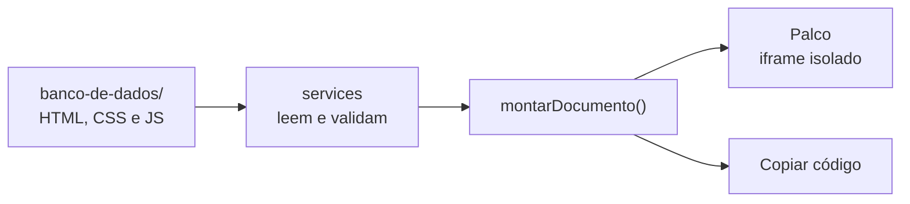

<div align="center">

# animaqui

### Navegue. Teste. Copie.

Laboratório visual de componentes web: seções prontas de sites para ver funcionando, ajustar e levar com um clique.


[](./LICENSE)

**75 seções** · **20 categorias** · **14 animações** · **0 bibliotecas no código copiado**

</div>

---

## Por que existe

Achar uma seção bonita é fácil. Difícil é levá-la para o seu site sem instalar biblioteca, traduzir de framework ou descobrir que ela quebra no celular.

No animaqui, o que você vê é exatamente o que você leva: **HTML, CSS e JavaScript puros, num texto só, prontos para colar em qualquer site.**

## O que dá para fazer

### 🧩 Catálogo de Seções

Explore as seções por categoria e teste cada variação ao vivo. Alterne entre celular e computador, aplique animações e copie o código.

### 🔤 Laboratório de Tipografia

Digite sua frase, troque a fonte com um clique usando o Google Fonts e experimente animações de texto, como máquina de escrever e letras surgindo.

### 🏗️ Montador de Páginas

Empilhe blocos, reordene arrastando ou pelo teclado, veja a página inteira funcionando e copie o site completo.

### 🛍️ Lojas prontas

Três lojas virtuais completas (lanchonete, moda e mercado), cada uma com várias páginas: vitrine, produto, carrinho, pagamento com Pix e pedido. Navegue dentro do palco, veja o carrinho somar entre as páginas e copie a loja inteira num único HTML.

## O acervo

| Categoria | Variações | | Categoria | Variações |
|---|:-:|---|---|:-:|
| Cabeçalho | 4 | | Galeria | 6 |
| Hero | 8 | | Marcas | 2 |
| Serviços | 6 | | FAQ | 4 |
| Sobre | 4 | | Chamada | 3 |
| Depoimentos | 4 | | Contato | 5 |
| Planos | 3 | | Rodapé | 3 |

**Animações de seção:** entrada, saída, paralaxe, zoom suave, revelar rolando, queda e acender, reflexo de luz.

**Animações de texto:** máquina de escrever, letras surgindo, palavras subindo, desfoque revelando, faixa de luz, brilho, gradiente.

Todas respeitam `prefers-reduced-motion` e nenhuma usa biblioteca.

## Como funciona

Toda seção é guardada em arquivos puros, e **uma função só** monta o que aparece no palco e o que vai para a área de transferência. Por isso os dois não têm como divergir.



- **Palco isolado:** a seção roda em um `iframe` com `sandbox`, então o botão Celular aciona as media queries de verdade e nenhum estilo vaza.
- **Só o necessário:** o código copiado leva apenas os tokens, as animações e as fontes em uso.
- **Sem conflito:** o CSS de cada seção fica sob uma classe própria, e o mesmo bloco pode entrar duas vezes na página.
- **Carregamento leve:** o código de uma seção só é baixado quando ela é aberta.

## Rodando localmente

Requisito: Node.js 20.9 ou superior.

```bash
git clone https://github.com/dg-2025/animaqui.git
cd animaqui
npm install
npm run dev
```

Depois, abra [http://localhost:3000](http://localhost:3000).

### Variáveis de ambiente (opcionais)

| Variável | Para que serve |
|---|---|
| `GOOGLE_FONTS_API_KEY` | Libera o catálogo completo do Google Fonts. Sem ela, a Tipografia usa uma lista de 40 fontes. Fica só no servidor. |
| `NEXT_PUBLIC_SITE_URL` | Endereço público do site, usado no sitemap, no canonical e na imagem de compartilhamento. Obrigatória ao publicar; sem ela, esses links apontam para `http://localhost:3000`. |

## Adicionando uma seção

O catálogo cresce sem mudar código. Crie uma pasta em `banco-de-dados/secoes/<categoria>/<id>/`:

```text
hero-09/
├── meta.json     # nome e descrição
├── secao.html    # a marcação
├── estilo.css    # o visual
└── script.js     # opcional
```

```json
{
  "id": "hero-09",
  "nome": "Hero com destaque",
  "categoria": "hero",
  "descricao": "Título grande com um bloco de destaque ao lado."
}
```

Três regras:

1. O `id` e a `categoria` precisam ser iguais aos nomes das pastas.
2. Todo o CSS fica dentro da classe raiz da seção, que é o `id` sem o hífen: `hero-09` vira `.hero09`. Keyframes levam a classe como prefixo.
3. O `script.js` recebe a variável `raiz`, que é o elemento da seção. Use `raiz.querySelector()` em vez de buscar no documento inteiro.

Se algo estiver fora do contrato, a validação aponta o arquivo que precisa de correção.

## Stack

| Camada | Tecnologia |
|---|---|
| Framework | Next.js 16 (App Router) |
| Interface | React 19 e CSS Modules |
| Linguagem | TypeScript em modo `strict` |
| Dados | Arquivos locais, validados com Zod e lidos com SWR |
| Ícones | Lucide |

## Estrutura

```text
animaqui/
├── banco-de-dados/     # o conteúdo: seções, animações e tema
└── src/
    ├── app/            # rotas e API
    ├── features/       # secoes, animacoes, tipografia, montador, motor
    ├── shared/         # componentes e utilitários comuns
    └── views/          # composição das telas
```

Requisitos, regras de negócio e decisões de arquitetura estão no [`DOCUMENTACAO.md`](./DOCUMENTACAO.md).

## Licença

Distribuído sob a licença [MIT](./LICENSE).

---

<div align="center">

Feito por Daniel. Se o animaqui te ajudou, deixe uma ⭐

</div>
